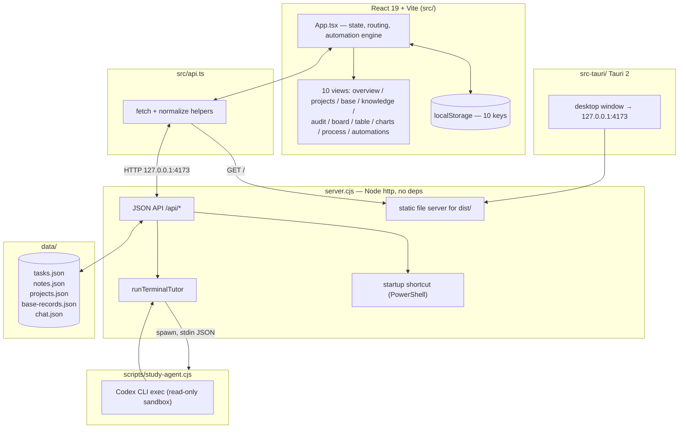
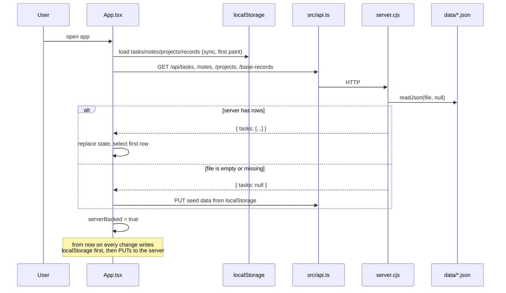
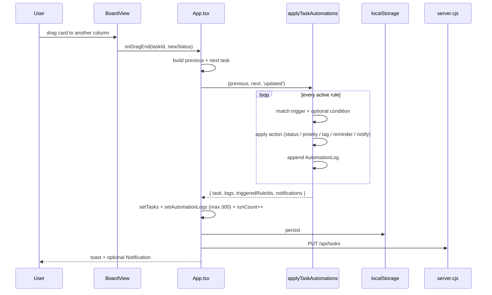
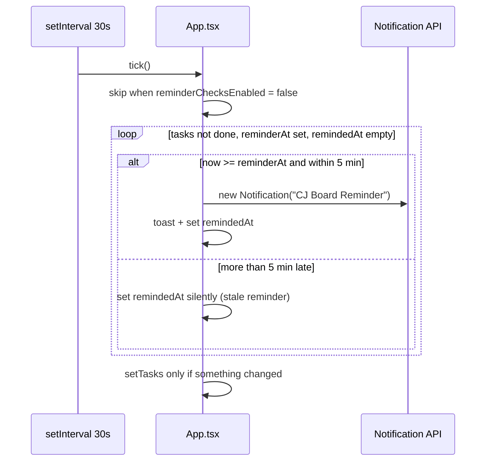
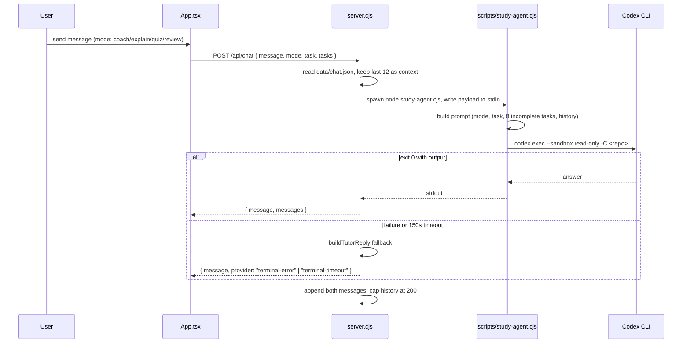
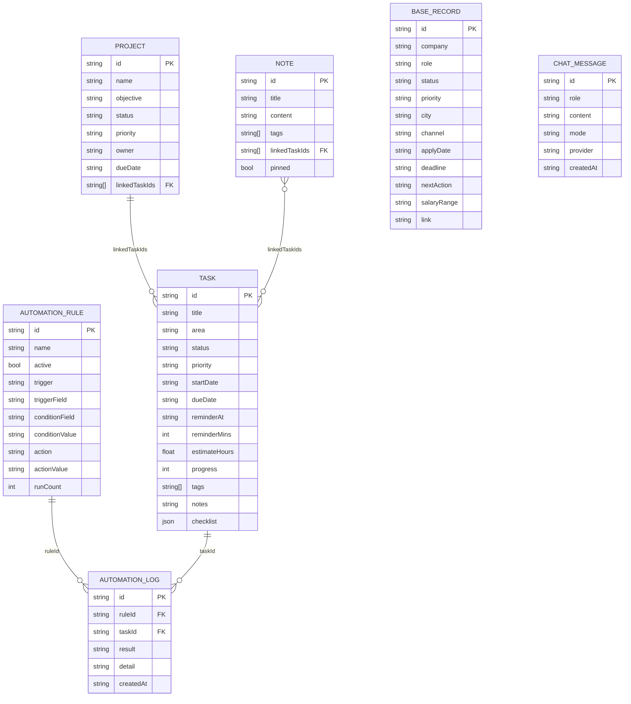
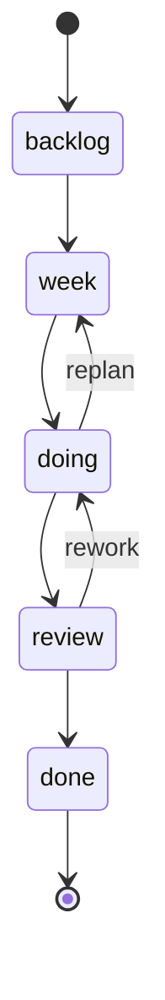
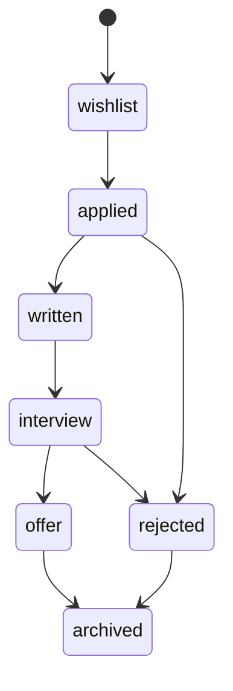

# CJ Board — Study & Task Management Board

[English](README.md) | [简体中文](README.zh-CN.md)

A local-first study and task board for one person: kanban, projects, a job-application
tracker, notes with links, automation rules and charts, all stored as plain JSON on your
own machine. The UI is React 19 + Vite; `server.cjs` is a dependency-free Node HTTP server
that persists to `data/*.json` and serves the built frontend; `src-tauri/` wraps the same
build as a Windows desktop app. An optional bridge sends questions to a local Codex CLI.

<p align="left">
  
</p>

---

## Overview

CJ Board is the board the author uses to run study plans, coursework, side projects and a
job search in one place. It deliberately avoids a database and a login: the whole data set
is a handful of JSON files in `data/`, and the app runs either in a browser via `npm run dev`
or as a Tauri window that starts a local server on `127.0.0.1:4173`.

Three storage tiers coexist:

| Tier | Used when | Where |
|---|---|---|
| Server JSON | `server.cjs` is running (desktop app, `npm run serve`) | `data/tasks.json`, `data/notes.json`, `data/projects.json`, `data/base-records.json`, `data/chat.json` |
| `localStorage` | always, as the first paint and as fallback | 10 keys, see [Configuration](#configuration) |
| In-memory | MVP-only state such as the chat draft | React state |

The app is single-user by design. There is no authentication, no multi-device sync, and the
HTTP server binds to loopback only.

---

## Table of Contents

- [Features](#features)
- [Architecture](#architecture)
- [Runtime modes](#runtime-modes)
- [Key flows](#key-flows)
- [Data model](#data-model)
- [Scoring rules](#scoring-rules)
- [HTTP API](#http-api)
- [Directory layout](#directory-layout)
- [Getting started](#getting-started)
- [Commands](#commands)
- [Configuration](#configuration)
- [Desktop packaging](#desktop-packaging)
- [Troubleshooting](#troubleshooting)
- [Design decisions & limitations](#design-decisions--limitations)
- [FAQ](#faq)
- [License](#license)

---

## Features

**Task board**
- Kanban with five stages (`backlog`, `week`, `doing`, `review`, `done`) and drag-and-drop
  via `@hello-pangea/dnd` (`src/components/BoardView.tsx`).
- Table and timeline/chart views over the same task set.
- Per-task checklist, estimate hours, tags, free-text notes, start/due dates and a reminder
  time.
- Four plan templates — Learning Plan, Project Plan, Coursework, Daily Plan — that create a
  pre-filled task set (`src/constants.tsx:122`, `createTemplateTasks`).

**Projects**
- Portfolio view with progress derived from linked tasks, plus a risk label
  (`Normal / Due soon / High risk / Overdue project / Blocked`) computed in `utils.ts`.

**Base (job-application tracker)**
- `BaseRecord` rows with company, role, channel, city, salary range, next action and link.
- Five view modes: grid, kanban, timeline, gallery, stats.
- CSV export (`baseRecordsToCsv`).
- Feishu connector settings (embed URL, app token, table id, view id, app id, tenant) stored
  locally so a Bitable can be embedded.

**Knowledge**
- Notes with `[[wiki-link]]` syntax, pinning, tag filtering and a force-graph of
  note↔note and note↔task links (`buildKnowledgeGraph`).

**Automation**
- Rules with a trigger (`task_created`, `record_updated`, `condition_matched`, `due_time`)
  and an action (`set_status`, `set_priority`, `add_tag`, `set_reminder`, `notify`).
- Run log capped at 300 entries; per-rule `runCount` kept.
- `due_time` rules run once per task per day.

**Learning chat**
- Coach / Explain / Quiz / Review modes.
- Messages are sent to `POST /api/chat`, which shells out to `scripts/study-agent.cjs` →
  local Codex CLI. When the CLI is missing or fails, a deterministic built-in reply is
  returned instead (`buildTutorReply`).

**Desktop & system integration**
- Tauri 2 shell (`src-tauri/`), product name `CJ Board`, identifier `com.novak.cjboard`.
- Optional "start on sign-in": `server.cjs` writes a shortcut into the Windows Startup
  folder pointing at `src-tauri/target/release/cj-board.exe`.
- Browser notifications for reminders and automation actions (permission-gated).

**Audit view** — a self-check page that flags stale tasks, missing reminders, empty records
and other housekeeping issues (`src/components/AuditView.tsx`).

---

## Architecture



| Layer | Path | Responsibility |
|---|---|---|
| Shell | `src-tauri/` | Window, bundling, `devUrl = http://127.0.0.1:4173`, `frontendDist = ../dist` |
| UI | `src/App.tsx` | All top-level state, view switching, reminder tick, automation engine |
| Views | `src/components/*View.tsx` | Pure-ish renderers over props handed down by `App.tsx` |
| Shared logic | `src/utils.ts`, `src/constants.tsx` | Normalisation, seeds, progress/risk math, storage keys, status metadata |
| HTTP client | `src/api.ts` | One function per endpoint, returns `null` when the server is absent |
| Server | `server.cjs` | JSON persistence, static hosting, SPA fallback, tutor bridge, startup shortcut |
| Bridge | `scripts/study-agent.cjs` | Builds a prompt, runs `codex exec`, returns stdout |
| Data | `data/*.json` | The entire database |

---

## Runtime modes

| Mode | Command | Backend | Persistence |
|---|---|---|---|
| Browser dev | `npm run dev` | Vite dev server (no `/api`) | `localStorage` only — API calls fail closed and the UI keeps working |
| Local server | `npm run build` then `npm run serve` | `server.cjs` on `127.0.0.1:4173` | `localStorage` + `data/*.json` |
| Desktop | `Open-CJBoard.cmd` / `npm run tauri:dev` | Tauri window over the local server | `localStorage` + `data/*.json` |
| Autostart | `Startup-CJBoard.cmd` in the Startup folder | Release build if present, otherwise dev server | same |

`src/api.ts` never throws on a missing backend: each `fetch` rejects, `App.tsx` sets the
matching `*ServerBacked` flag to `false`, and the app continues on `localStorage`.
*(source: `src/api.ts`, `src/App.tsx:201-250`)*

---

## Key flows

### 1. Startup hydration (server wins, localStorage seeds it)



The `hasLoadedServer` ref guards the write-back effects so a fresh load cannot overwrite
the file with an empty array before hydration finishes.

### 2. Task change → automation rules



Trigger matching is narrow on purpose: `record_updated` fires only when the watched field
actually changed between `previous` and `input`; `condition_matched` fires on the transition
from not-matching to matching. *(source: `src/App.tsx:455-545`)*

### 3. Reminder tick



The 5-minute grace window (`STALE_REMINDER_GRACE_MS`) stops a laptop that was asleep from
firing a burst of old reminders on wake.

### 4. Learning chat → local Codex CLI



`STUDYBOARD_CHAT_COMMAND` can replace the whole child process, which makes the endpoint
testable without Codex installed. *(source: `server.cjs:196-266`, `scripts/study-agent.cjs`)*

---

## Data model



Relations are stored as ID arrays, not foreign keys — the server never validates or joins
them. `getProjectTasks` simply drops IDs that no longer resolve.

### Task lifecycle



Stage weights feed progress: `backlog 0`, `week 18`, `doing 45`, `review 82`, `done 100`
(`statusProgress` in `src/utils.ts`).

### Base record lifecycle (job applications)



---

## Scoring rules

Both formulas live in `src/utils.ts` and are pure functions — no state, no randomness.

**Task progress**

```
progress = status === 'done' ? 100
         : max(statusProgress[status], checklistDone / checklistTotal * 100)
```

A checklist can push progress above its stage baseline but never below it.

**Risk level** (`getRiskLevel`)

| Condition | Label |
|---|---|
| `status === 'done'` | Done |
| `daysUntilDue < 0` | Overdue |
| `priority === 'high'` and `daysUntilDue <= 2` | High risk |
| `daysUntilDue <= 3` | Due soon |
| otherwise | Normal |

**Risk score** (`getRiskScore`, used to sort the overview)

```
priorityRank * 10 + (overdue ? 80 : max(0, 18 - daysUntilDue * 3))
  + (doing ? 8 : week ? 5 : 0) - progress / 8
```

---

## HTTP API

All routes are handled by a single `http.createServer` callback with `if` chains — there is
no router library. Responses are UTF-8 JSON; CORS is limited to `http://127.0.0.1:<port>`.

| Method | Path | Body | Response | Notes |
|---|---|---|---|---|
| GET | `/api/tasks` | — | `{ tasks: Task[] \| null }` | `null` means the file is missing/empty |
| PUT | `/api/tasks` | `{ tasks: Task[] }` | `{ ok: true }` | 400 if `tasks` is not an array |
| GET | `/api/notes` | — | `{ notes: Note[] \| null }` | |
| PUT | `/api/notes` | `{ notes: Note[] }` | `{ ok: true }` | |
| GET | `/api/projects` | — | `{ projects: Project[] \| null }` | |
| PUT | `/api/projects` | `{ projects: Project[] }` | `{ ok: true }` | |
| GET | `/api/base-records` | — | `{ records: BaseRecord[] \| null }` | |
| PUT | `/api/base-records` | `{ records: BaseRecord[] }` | `{ ok: true }` | |
| GET | `/api/chat` | — | `{ messages: ChatMessage[] }` | defaults to `[]` |
| POST | `/api/chat` | `{ message, mode, task, tasks }` | `{ message, messages }` | spawns the tutor, 150 s cap |
| GET | `/api/system/startup` | — | `{ supported, enabled, path }` | Windows only |
| PUT | `/api/system/startup` | `{ enabled: boolean }` | same shape | creates/removes the `.lnk` |
| GET | `/*` | — | `dist/*` or `index.html` | SPA fallback; path traversal → 403 |

Request bodies are capped at 10 MB (`readBody`), which is far above any legitimate payload.

---

## Directory layout

```text
learning-kanban/
├─ src/
│  ├─ App.tsx                 # state, views, reminder + automation loops
│  ├─ api.ts                  # HTTP client, one function per endpoint
│  ├─ types.ts                # Task, Note, Project, BaseRecord, Automation*, Settings
│  ├─ constants.tsx           # storage keys, status metadata, templates
│  ├─ utils.ts                # seeds, normalisers, progress/risk math, CSV
│  └─ components/
│     ├─ BoardView.tsx        # kanban + drag and drop
│     ├─ OverviewView.tsx     # daily command centre
│     ├─ ProjectManagementView.tsx
│     ├─ BaseRecordsView.tsx  # job-application tracker, 5 view modes
│     ├─ KnowledgeView.tsx    # notes + link graph
│     ├─ AutomationCenter.tsx # rules and run log
│     ├─ AuditView.tsx        # housekeeping checks
│     ├─ ChartsView.tsx       # ECharts dashboards
│     ├─ ProcessView.tsx      # learning-process nodes
│     ├─ TaskDetail.tsx, SettingsPanel.tsx, common.tsx, markdown.tsx
│     └─ chartBuilders.ts     # pure ECharts option builders
├─ src-tauri/                 # Tauri 2 shell (Rust, config, icons)
├─ scripts/
│  ├─ study-agent.cjs         # prompt builder + Codex CLI invocation
│  ├─ start-server.ps1        # node server.cjs with STUDYBOARD_PORT
│  ├─ start-studyboard.ps1    # build/open helper
│  ├─ start-tauri-dev.ps1     # dev launcher
│  ├─ reminder-watch.ps1      # WPF tray reminder independent of the browser
│  ├─ install-tauri-prereqs.ps1, setup-*.ps1, tauri-build.cmd
├─ data/                      # the database (JSON)
├─ public/, assets/           # static assets and icons
├─ dist/                      # committed production build served by server.cjs
├─ server.cjs                 # HTTP server + tutor bridge + startup shortcut
├─ Open-CJBoard.cmd           # double-click launcher (exe if built, else dev)
├─ Startup-CJBoard.cmd        # same, used from the Startup folder
├─ vite.config.ts, tsconfig*.json, .oxlintrc.json
└─ README.md / README.zh-CN.md
```

---

## Getting started

Requirements: **Node 20.19+** (Vite 8 baseline), npm, and Windows for the desktop and
autostart features. Browser mode runs on macOS/Linux.

```bash
# 1. install
npm install

# 2. browser development (Vite only, no persistence beyond localStorage)
npm run dev

# 3. production build + local server
npm run build
npm run serve            # http://127.0.0.1:4173

# 4. lint (the `test` script currently points at a file not in this tree)
npm run lint             # oxlint

# 5. desktop
npm run setup-tauri      # install Rust + MSVC build tools once
npm run tauri:dev        # dev window
npm run tauri:build      # release exe at src-tauri/target/release/cj-board.exe
```

Windows shortcuts: double-click `Open-CJBoard.cmd` to launch the release exe if it exists,
otherwise the Tauri dev window.

---

## Commands

| Command | Does |
|---|---|
| `npm run dev` | Vite dev server |
| `npm run build` | `tsc -b` then `vite build` → `dist/` |
| `npm run preview` | Vite preview of `dist/` |
| `npm run serve` | `node server.cjs` on port 4173 |
| `npm run lint` | `oxlint` |
| `npm run test` | `node --test scripts/import.test.ts` — **the file is not in this tree, so the script fails** |
| `npm run setup-tauri` | `scripts/install-tauri-prereqs.ps1` (Rust toolchain, MSVC) |
| `npm run setup-desktop` | `scripts/setup-desktop.ps1` |
| `npm run setup-cjboard` | `scripts/setup-cjboard-tauri.ps1` |
| `npm run desktop:tauri` | `scripts/start-tauri-dev.ps1` |
| `npm run tauri:dev` / `tauri:build` | Tauri CLI |

---

## Configuration

### Environment variables

| Variable | Default | Purpose |
|---|---|---|
| `STUDYBOARD_PORT` | `4173` | Port for `server.cjs`; also used in the CORS header |
| `STUDYBOARD_CHAT_COMMAND` | `node scripts/study-agent.cjs` | Replaces the tutor child process entirely |
| `STUDYBOARD_CODEX_PATH` | `D:\nodejs\codex.cmd` | Codex CLI executable used by `study-agent.cjs` |
| `CODEX_HOME` | `D:\codex-data` | Codex config/data directory |
| `STUDYBOARD_CODEX_MODEL` | *(empty)* | Optional `-m` model override |

The two Windows paths are machine-specific defaults; override them before relying on the
chat feature on another machine.

### localStorage keys

| Key | Contents |
|---|---|
| `learning-kanban-v5` | tasks |
| `studyboard-notes-v1` | notes |
| `cj-board-projects-v1` | projects |
| `cj-board-base-records-v1` | base records |
| `cj-board-feishu-connector-v1` | Feishu embed settings |
| `cj-board-custom-tags-v1` | user-defined tags |
| `cj-board-automations-v1` | automation rules |
| `cj-board-automation-logs-v1` | run log (max 300) |
| `cj-board-settings-v1` | app settings |
| `(chat)` | chat history lives on the server only (`data/chat.json`) |

### App settings

| Setting | Default | Effect |
|---|---|---|
| `notificationsEnabled` | `false` | Browser notifications for reminders/automations |
| `reminderChecksEnabled` | `true` | 30 s reminder tick |
| `automationNotificationsEnabled` | `true` | Notifications from `notify` actions |
| `launchAtStartup` | `false` | Mirrors `/api/system/startup` state |
| `confirmDestructiveActions` | `true` | Confirmation dialogs before deletes |
| `defaultView` | `overview` | Landing view |
| `interfaceDensity` | `comfortable` | `comfortable` or `compact` |
| `weekStartsOn` | `Monday` | Timeline alignment |

---

## Desktop packaging

`src-tauri/tauri.conf.json`: `productName: "CJ Board"`, `identifier: "com.novak.cjboard"`,
`frontendDist: "../dist"`, `devUrl: "http://127.0.0.1:4173"`, bundle targets `all`.

Enabling "launch at startup" makes `server.cjs` write
`%APPDATA%\Microsoft\Windows\Start Menu\Programs\Startup\CJ Board.lnk` pointing at
`src-tauri/target/release/cj-board.exe`. It refuses to enable when that exe is missing, so
build the release binary before turning the toggle on.

---

## Troubleshooting

| Symptom | Cause | Fix |
|---|---|---|
| Changes vanish after restart | Running under `npm run dev` — no `/api`, so only `localStorage` persists, and the desktop app uses a different origin | Run `npm run serve` or the Tauri app |
| "Startup settings are only supported on Windows." | `APPDATA` missing or non-Windows host | Expected on macOS/Linux |
| Toggle for autostart does nothing | Release exe not built | `npm run tauri:build`, then retry |
| Chat replies with "The terminal learning agent failed." | `codex` not at `STUDYBOARD_CODEX_PATH` | Set the env var or `STUDYBOARD_CHAT_COMMAND` |
| Chat answers arrive after ~2.5 min | Server-side 150 s cap on the child process, 120 s inside the agent | Shorten prompts; check Codex latency |
| Reminders never appear | `notificationsEnabled` off or browser permission denied | Enable in settings and grant permission |
| Reminder fires immediately on wake | Should not happen — reminders older than 5 min are marked silently | If it does, check `STALE_REMINDER_GRACE_MS` |
| 403 on a static file | Path traversal guard rejected a normalised path outside `dist/` | Use a normal URL; this is intentional |
| Port already in use | Another instance of `server.cjs` | `STUDYBOARD_PORT=4180 npm run serve` |

---

## Design decisions & limitations

- **No database.** JSON files keep the project dependency-free and easy to inspect or back
  up, at the cost of no concurrent writers and no query layer. The whole file is rewritten
  on every save.
- **Dual write.** `localStorage` renders instantly and survives a missing backend; the
  server file is the durable copy when it is running. They can diverge if you switch modes
  (browser dev vs desktop), because they are different origins.
- **Single user, loopback only.** No auth, no TLS, no CSRF tokens. Do not expose port 4173.
- **Windows-leaning.** Autostart and the reminder watcher are PowerShell/WPF; the tutor
  defaults point at `D:\` paths. Browser mode is the portable path.
- **`dist/` is committed.** The server serves the committed build, so remember to rebuild
  after frontend changes.
- **Simulated agent fallback.** If Codex is absent, `buildTutorReply` produces a scripted
  coaching reply. It is not a language model — treat it as a template, not an answer.
- **No tests for UI logic.** `package.json` declares `node --test scripts/import.test.ts`,
  but that file is not present in this tree, so `npm run test` currently fails. Risk and
  progress math has no coverage.

---

## FAQ

**Is my data uploaded anywhere?** No. It stays in `data/*.json` and `localStorage`. The only
outbound call is the Codex CLI, which runs locally.

**Can two windows share data?** Yes while the server runs — both talk to `127.0.0.1:4173`,
but last write wins because the whole array is replaced.

**How do I back up?** Copy `data/` and, for browser mode, export `localStorage`.

**Why do some tasks show 45% with nothing done?** Progress has a stage floor: `doing`
starts at 45%. Use checklists for finer granularity.

**What is "Base"?** A job-application tracker (company, role, stage, next action) with five
view modes and CSV export.

**Can I add a new view?** Add a `ViewKey` in `src/types.ts`, a nav entry in `App.tsx`, and a
component; state flows down as props.

**Does the Feishu connector sync data?** No — it only stores embed settings used to render a
Bitable view; nothing is written back to Feishu.

---

## License

No license file is included in this repository. Treat it as all rights reserved unless the
author states otherwise.
