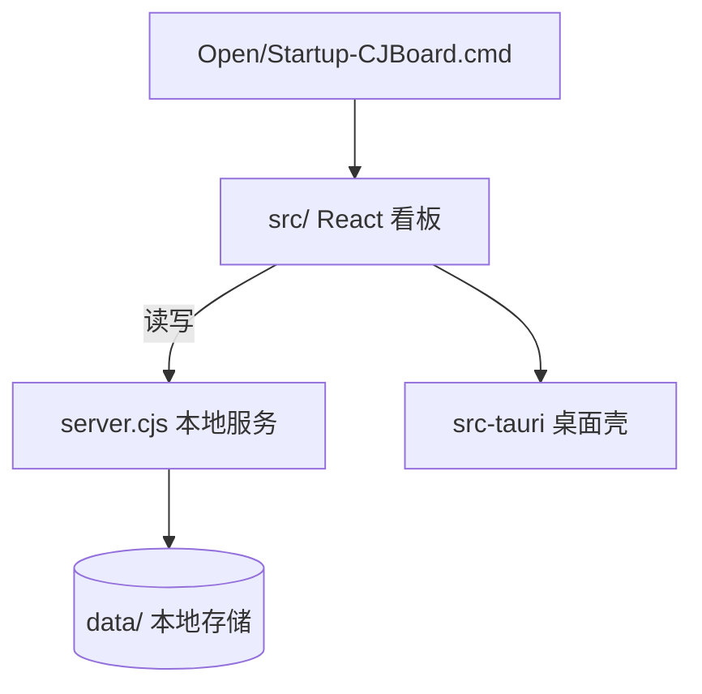

# CJ Board 学习与任务管理看板（learning-kanban）

基于 **React + TypeScript + Vite + Tauri** 的学习/任务管理看板，含本地 Node 服务 `server.cjs` 与 `data/` 存储，可作为桌面应用运行。

## 主要功能
- 学习/任务看板（拖拽/分列）
- 桌面应用封装（Tauri，`src-tauri/`）
- 本地服务与启动脚本（`server.cjs`、`Open-CJBoard.cmd`、`Startup-CJBoard.cmd`）

## 技术栈
React 19 · TypeScript · Vite · Tauri · Node(server.cjs)

## 架构与流程


## 项目结构
```
learning-kanban/
├─ src/            # React 前端
├─ src-tauri/      # Tauri 桌面壳
├─ server.cjs      # 本地服务
├─ data/           # 数据
├─ scripts/        # 脚本
├─ public/ assets/
├─ package.json / vite.config.ts / tsconfig*.json
└─ README.md / README_EN.md
```

## 快速开始
```
npm install
npm run dev                 # 浏览器开发
# 或双击 Open-CJBoard.cmd 启动；桌面构建见 src-tauri
```

## 许可证
见仓库。