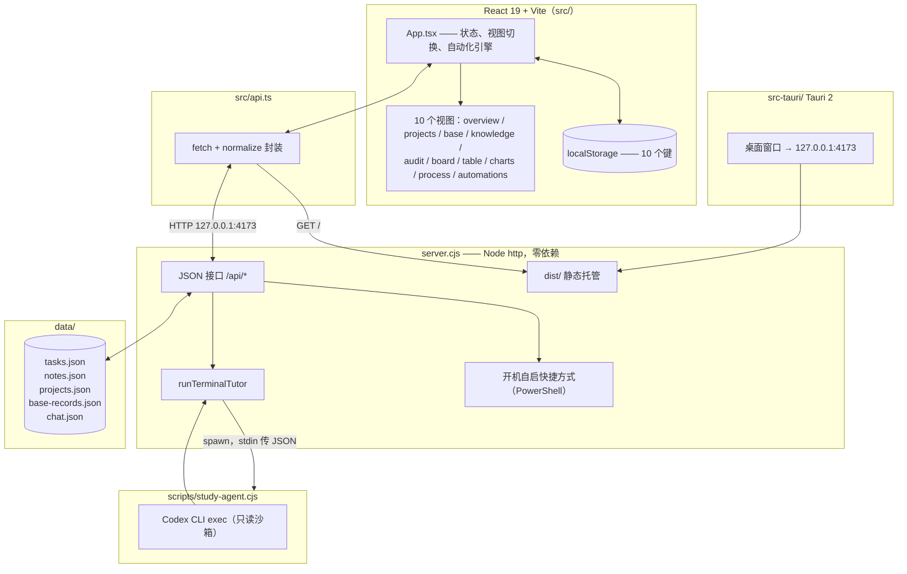
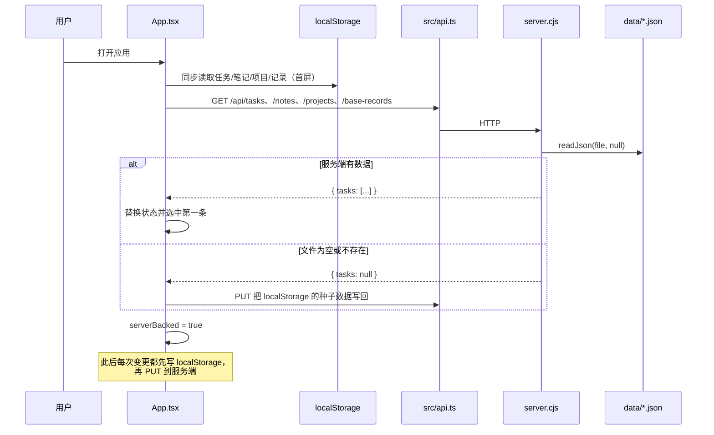
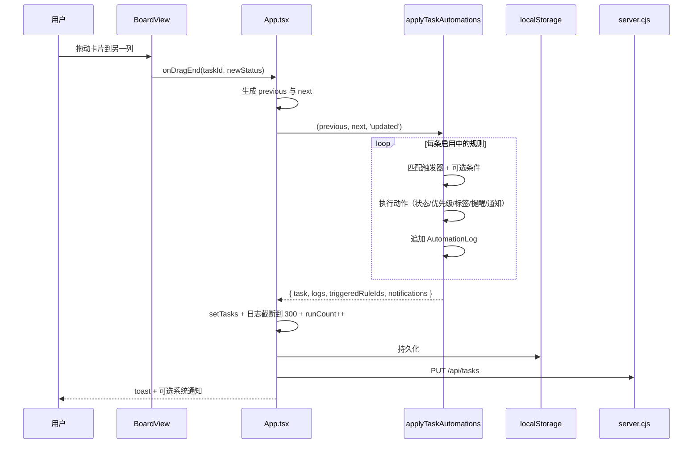
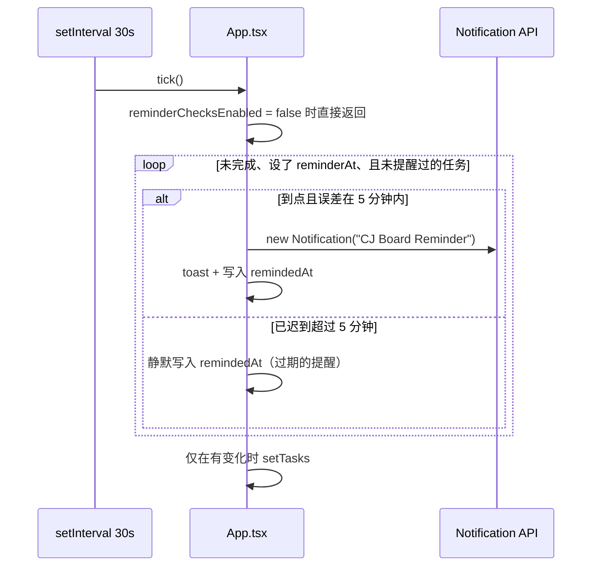
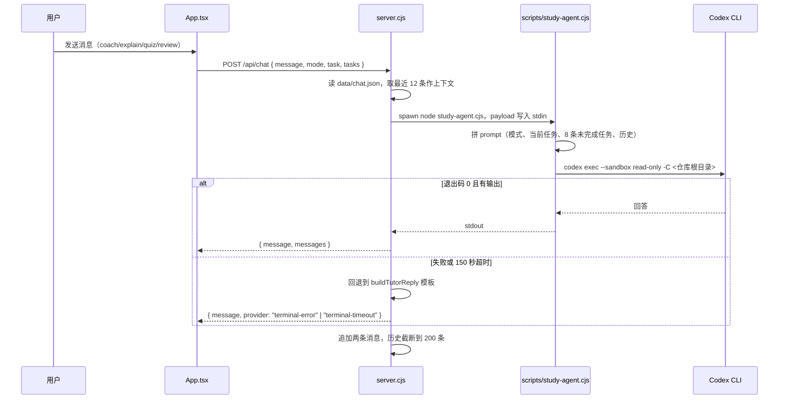
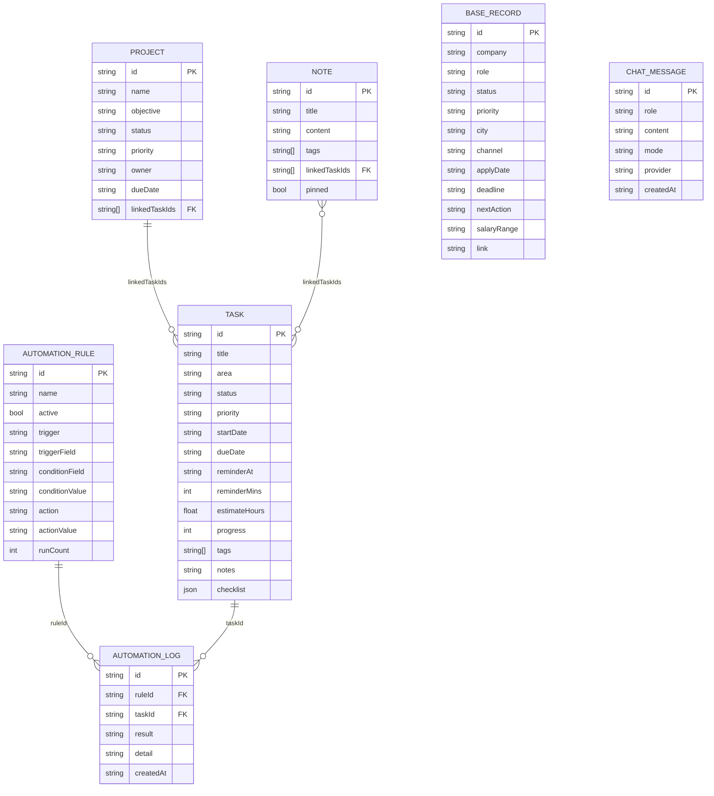
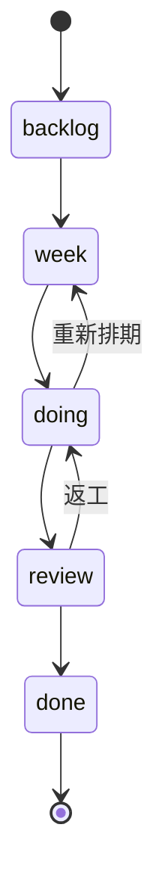
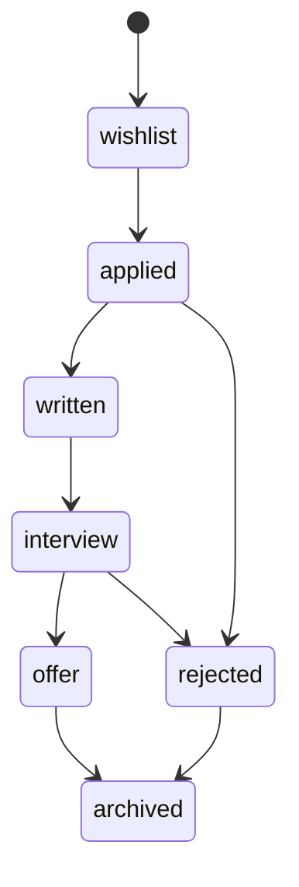

# CJ Board — 学习与任务管理看板

[English](README.md) | [简体中文](README.zh-CN.md)

一个给单人用的本地优先学习 / 任务看板：看板、项目、求职记录、带链接的笔记、自动化规则和图表，
数据全部以 JSON 文件存在本机。UI 是 React 19 + Vite；`server.cjs` 是一个零依赖的 Node HTTP
服务，负责把数据落到 `data/*.json` 并托管构建产物；`src-tauri/` 把同一份构建包成 Windows
桌面应用。可选的学习对话会把问题转给本机 Codex CLI。

<p align="left">
  
</p>

---

## 概览

CJ Board 是作者用来自管学习计划、课程作业、副业项目和求职进展的看板。它刻意不用数据库、不做登录：
整个数据集就是 `data/` 下的几个 JSON 文件，应用既可以用 `npm run dev` 跑在浏览器里，也可以作为
Tauri 窗口运行——后者会在 `127.0.0.1:4173` 起一个本地服务。

三种存储并存：

| 层 | 生效条件 | 位置 |
|---|---|---|
| 服务端 JSON | `server.cjs` 在运行（桌面应用、`npm run serve`） | `data/tasks.json`、`data/notes.json`、`data/projects.json`、`data/base-records.json`、`data/chat.json` |
| `localStorage` | 始终启用，负责首屏与降级 | 10 个键，见[配置](#配置) |
| 内存 | 仅聊天草稿等临时状态 | React state |

应用按单用户设计：没有鉴权、没有多端同步，HTTP 服务只监听回环地址。

---

## 目录

- [功能](#功能)
- [架构](#架构)
- [运行模式](#运行模式)
- [关键流程](#关键流程)
- [数据模型](#数据模型)
- [评分规则](#评分规则)
- [HTTP 接口](#http-接口)
- [目录结构](#目录结构)
- [快速开始](#快速开始)
- [命令](#命令)
- [配置](#配置)
- [桌面打包](#桌面打包)
- [排错](#排错)
- [设计取舍与已知限制](#设计取舍与已知限制)
- [FAQ](#faq)
- [许可](#许可)

---

## 功能

**任务看板**
- 五列看板（`backlog`、`week`、`doing`、`review`、`done`），基于 `@hello-pangea/dnd` 实现拖拽
  （`src/components/BoardView.tsx`）。
- 表格视图与时间线 / 图表视图共用同一份任务数据。
- 每个任务支持清单、预估工时、标签、备注、开始 / 截止日期与提醒时间。
- 四种计划模板——Learning Plan、Project Plan、Coursework、Daily Plan——可一次生成预填任务
  （`src/constants.tsx:122`、`createTemplateTasks`）。

**项目**
- 项目组合视图，进度由关联任务推导，并给出风险标签
  （`Normal / Due soon / High risk / Overdue project / Blocked`，见 `utils.ts`）。

**Base（求职记录）**
- `BaseRecord` 记录公司、岗位、投递渠道、城市、薪资区间、下一步动作和链接。
- 五种视图：网格、看板、时间线、画廊、统计。
- 支持导出 CSV（`baseRecordsToCsv`）。
- 可保存飞书嵌入配置（embed URL、app token、table id、view id、app id、租户），用于内嵌多维表格。

**知识库**
- 笔记支持 `[[wiki-link]]` 语法、置顶、标签筛选，以及笔记↔笔记、笔记↔任务的关系图
  （`buildKnowledgeGraph`）。

**自动化**
- 规则由触发条件（`task_created`、`record_updated`、`condition_matched`、`due_time`）和动作
  （`set_status`、`set_priority`、`add_tag`、`set_reminder`、`notify`）组成。
- 执行日志最多保留 300 条，并累加每条规则的 `runCount`。
- `due_time` 规则对同一任务每天只触发一次。

**学习对话**
- 教练 / 讲解 / 测验 / 复盘四种模式。
- 消息发到 `POST /api/chat`，服务端再调用 `scripts/study-agent.cjs` → 本机 Codex CLI。
  当 CLI 缺失或失败时，返回内置的确定性回复模板（`buildTutorReply`）。

**桌面与系统集成**
- Tauri 2 外壳（`src-tauri/`），产品名 `CJ Board`，标识符 `com.novak.cjboard`。
- 可选的“开机自启”：`server.cjs` 会在 Windows 启动目录写入一个指向
  `src-tauri/target/release/cj-board.exe` 的快捷方式。
- 提醒与自动化动作支持浏览器通知（需授权）。

**Audit 视图** —— 一个自检页，标出过期任务、缺失提醒、空记录等日常维护问题
（`src/components/AuditView.tsx`）。

---

## 架构



| 层 | 路径 | 职责 |
|---|---|---|
| 外壳 | `src-tauri/` | 窗口、打包、`devUrl = http://127.0.0.1:4173`、`frontendDist = ../dist` |
| UI | `src/App.tsx` | 全部顶层状态、视图切换、提醒轮询、自动化引擎 |
| 视图 | `src/components/*View.tsx` | 接收 `App.tsx` 下发的 props 做渲染 |
| 共享逻辑 | `src/utils.ts`、`src/constants.tsx` | 归一化、种子数据、进度 / 风险计算、存储键、状态元数据 |
| HTTP 客户端 | `src/api.ts` | 每个接口一个函数，服务端不存在时返回 `null` |
| 服务端 | `server.cjs` | JSON 持久化、静态托管、SPA 回退、对话桥接、开机自启 |
| 桥接 | `scripts/study-agent.cjs` | 拼 prompt、执行 `codex exec`、返回 stdout |
| 数据 | `data/*.json` | 全部数据库 |

---

## 运行模式

| 模式 | 命令 | 后端 | 持久化 |
|---|---|---|---|
| 浏览器开发 | `npm run dev` | Vite dev server（无 `/api`） | 仅 `localStorage`，接口失败后自动降级 |
| 本地服务 | `npm run build` 后 `npm run serve` | `server.cjs`，端口 4173 | `localStorage` + `data/*.json` |
| 桌面 | `Open-CJBoard.cmd` / `npm run tauri:dev` | Tauri 窗口 + 本地服务 | `localStorage` + `data/*.json` |
| 开机自启 | 启动目录里的 `Startup-CJBoard.cmd` | 有 release 产物则用 exe，否则起 dev | 同上 |

`src/api.ts` 在缺少后端时不会抛到 UI：每个 `fetch` 失败后，`App.tsx` 把对应的
`*ServerBacked` 置为 `false`，应用继续用 `localStorage` 工作。
*(来源：`src/api.ts`、`src/App.tsx:201-250`)*

---

## 关键流程

### 1. 启动时的数据加载（服务端优先，localStorage 兜底）



`hasLoadedServer` 这个 ref 用来拦住写回副作用，避免刚加载时用空数组覆盖文件。

### 2. 任务变更 → 触发自动化



触发匹配是刻意收紧的：`record_updated` 只在被监听字段于 `previous` 和 `input` 之间真的发生变化时
才触发；`condition_matched` 只在“不满足 → 满足”的跳变时触发。*(来源：`src/App.tsx:455-545`)*

### 3. 提醒轮询



5 分钟的宽限窗口（`STALE_REMINDER_GRACE_MS`）避免笔记本休眠后醒来一次性弹出一堆旧提醒。

### 4. 学习对话 → 本机 Codex CLI



`STUDYBOARD_CHAT_COMMAND` 可以整体替换子进程，因此在没装 Codex 的机器上也能测这个接口。
*(来源：`server.cjs:196-266`、`scripts/study-agent.cjs`)*

---

## 数据模型



关联关系以 ID 数组保存，不是外键——服务端既不校验也不 join；`getProjectTasks` 会直接丢弃
已经解析不到的 ID。

### 任务状态流转



阶段权重参与进度计算：`backlog 0`、`week 18`、`doing 45`、`review 82`、`done 100`
（`src/utils.ts` 里的 `statusProgress`）。

### Base 记录流转（求职）



---

## 评分规则

两个公式都在 `src/utils.ts`，是纯函数——无状态、无随机。

**任务进度**

```
progress = status === 'done' ? 100
         : max(statusProgress[status], 已完成清单项 / 清单总数 * 100)
```

清单只能把进度抬到阶段基线之上，不能拉低到基线之下。

**风险等级**（`getRiskLevel`）

| 条件 | 标签 |
|---|---|
| `status === 'done'` | Done |
| 距截止日 < 0 天 | Overdue |
| `priority === 'high'` 且距截止日 ≤ 2 天 | High risk |
| 距截止日 ≤ 3 天 | Due soon |
| 其他 | Normal |

**风险分**（`getRiskScore`，用于概览页排序）

```
priorityRank * 10 + (已逾期 ? 80 : max(0, 18 - 距截止天数 * 3))
  + (doing ? 8 : week ? 5 : 0) - progress / 8
```

---

## HTTP 接口

所有路由都由一个 `http.createServer` 回调里的 `if` 串联处理——没有路由库。响应是 UTF-8 JSON，
CORS 只放行 `http://127.0.0.1:<port>`。

| 方法 | 路径 | 请求体 | 响应 | 说明 |
|---|---|---|---|---|
| GET | `/api/tasks` | — | `{ tasks: Task[] \| null }` | `null` 表示文件缺失或为空 |
| PUT | `/api/tasks` | `{ tasks: Task[] }` | `{ ok: true }` | `tasks` 不是数组时返回 400 |
| GET | `/api/notes` | — | `{ notes: Note[] \| null }` | |
| PUT | `/api/notes` | `{ notes: Note[] }` | `{ ok: true }` | |
| GET | `/api/projects` | — | `{ projects: Project[] \| null }` | |
| PUT | `/api/projects` | `{ projects: Project[] }` | `{ ok: true }` | |
| GET | `/api/base-records` | — | `{ records: BaseRecord[] \| null }` | |
| PUT | `/api/base-records` | `{ records: BaseRecord[] }` | `{ ok: true }` | |
| GET | `/api/chat` | — | `{ messages: ChatMessage[] }` | 默认 `[]` |
| POST | `/api/chat` | `{ message, mode, task, tasks }` | `{ message, messages }` | 调起对话子进程，上限 150 秒 |
| GET | `/api/system/startup` | — | `{ supported, enabled, path }` | 仅 Windows |
| PUT | `/api/system/startup` | `{ enabled: boolean }` | 同上 | 创建 / 删除 `.lnk` |
| GET | `/*` | — | `dist/*` 或 `index.html` | SPA 回退；路径穿越返回 403 |

请求体上限 10 MB（`readBody`），远高于任何正常负载。

---

## 目录结构

```text
learning-kanban/
├─ src/
│  ├─ App.tsx                 # 状态、视图、提醒与自动化轮询
│  ├─ api.ts                  # HTTP 客户端，一个接口一个函数
│  ├─ types.ts                # Task、Note、Project、BaseRecord、Automation*、Settings
│  ├─ constants.tsx           # 存储键、状态元数据、计划模板
│  ├─ utils.ts                # 种子数据、归一化、进度/风险计算、CSV
│  └─ components/
│     ├─ BoardView.tsx        # 看板 + 拖拽
│     ├─ OverviewView.tsx     # 每日指挥台
│     ├─ ProjectManagementView.tsx
│     ├─ BaseRecordsView.tsx  # 求职记录，5 种视图
│     ├─ KnowledgeView.tsx    # 笔记 + 关系图
│     ├─ AutomationCenter.tsx # 规则与执行日志
│     ├─ AuditView.tsx        # 日常维护自检
│     ├─ ChartsView.tsx       # ECharts 仪表盘
│     ├─ ProcessView.tsx      # 学习流程节点
│     ├─ TaskDetail.tsx、SettingsPanel.tsx、common.tsx、markdown.tsx
│     └─ chartBuilders.ts     # 纯函数，产出 ECharts option
├─ src-tauri/                 # Tauri 2 外壳（Rust、配置、图标）
├─ scripts/
│  ├─ study-agent.cjs         # 拼 prompt + 调用 Codex CLI
│  ├─ start-server.ps1        # 带 STUDYBOARD_PORT 启动 server.cjs
│  ├─ start-studyboard.ps1    # 构建/打开辅助
│  ├─ start-tauri-dev.ps1     # 开发启动器
│  ├─ reminder-watch.ps1      # 不依赖浏览器的 WPF 桌面提醒
│  ├─ install-tauri-prereqs.ps1、setup-*.ps1、tauri-build.cmd
├─ data/                      # 数据库（JSON）
├─ public/、assets/           # 静态资源与图标
├─ dist/                      # 已提交的构建产物，由 server.cjs 托管
├─ server.cjs                 # HTTP 服务 + 对话桥接 + 开机自启
├─ Open-CJBoard.cmd           # 双击启动（有 exe 用 exe，否则起 dev）
├─ Startup-CJBoard.cmd        # 同上，供启动目录使用
├─ vite.config.ts、tsconfig*.json、.oxlintrc.json
└─ README.md / README.zh-CN.md
```

---

## 快速开始

环境要求：**Node 20.19+**（Vite 8 的基线）、npm；桌面与开机自启功能需要 Windows。浏览器模式可在
macOS / Linux 上跑。

```bash
# 1. 安装
npm install

# 2. 浏览器开发（纯 Vite，无 /api，只写 localStorage）
npm run dev

# 3. 构建 + 本地服务
npm run build
npm run serve            # http://127.0.0.1:4173

# 4. 检查（注意：test 脚本指向的文件不在本仓库中）
npm run lint             # oxlint

# 5. 桌面
npm run setup-tauri      # 一次性安装 Rust + MSVC 构建工具
npm run tauri:dev        # 开发窗口
npm run tauri:build      # 产物：src-tauri/target/release/cj-board.exe
```

Windows 快捷方式：双击 `Open-CJBoard.cmd`，存在 release 产物就启动 exe，否则拉起 Tauri 开发窗口。

---

## 命令

| 命令 | 作用 |
|---|---|
| `npm run dev` | Vite 开发服务器 |
| `npm run build` | `tsc -b` 后 `vite build` → `dist/` |
| `npm run preview` | 预览 `dist/` |
| `npm run serve` | `node server.cjs`，端口 4173 |
| `npm run lint` | `oxlint` |
| `npm run test` | `node --test scripts/import.test.ts` —— **该文件不在本仓库中，脚本会失败** |
| `npm run setup-tauri` | `scripts/install-tauri-prereqs.ps1`（Rust 工具链、MSVC） |
| `npm run setup-desktop` | `scripts/setup-desktop.ps1` |
| `npm run setup-cjboard` | `scripts/setup-cjboard-tauri.ps1` |
| `npm run desktop:tauri` | `scripts/start-tauri-dev.ps1` |
| `npm run tauri:dev` / `tauri:build` | Tauri CLI |

---

## 配置

### 环境变量

| 变量 | 默认值 | 用途 |
|---|---|---|
| `STUDYBOARD_PORT` | `4173` | `server.cjs` 监听端口，同时用于 CORS 头 |
| `STUDYBOARD_CHAT_COMMAND` | `node scripts/study-agent.cjs` | 整体替换对话子进程 |
| `STUDYBOARD_CODEX_PATH` | `D:\nodejs\codex.cmd` | `study-agent.cjs` 调用的 Codex CLI |
| `CODEX_HOME` | `D:\codex-data` | Codex 配置与数据目录 |
| `STUDYBOARD_CODEX_MODEL` | 空 | 可选的 `-m` 模型覆盖 |

两个 Windows 路径是本机默认值，换机器使用对话功能前请自行覆盖。

### localStorage 键

| 键 | 内容 |
|---|---|
| `learning-kanban-v5` | 任务 |
| `studyboard-notes-v1` | 笔记 |
| `cj-board-projects-v1` | 项目 |
| `cj-board-base-records-v1` | Base 记录 |
| `cj-board-feishu-connector-v1` | 飞书嵌入配置 |
| `cj-board-custom-tags-v1` | 自定义标签 |
| `cj-board-automations-v1` | 自动化规则 |
| `cj-board-automation-logs-v1` | 执行日志（最多 300 条） |
| `cj-board-settings-v1` | 应用设置 |
| `(chat)` | 聊天记录只存在服务端 `data/chat.json` |

### 应用设置

| 设置项 | 默认值 | 作用 |
|---|---|---|
| `notificationsEnabled` | `false` | 提醒 / 自动化的系统通知 |
| `reminderChecksEnabled` | `true` | 30 秒提醒轮询 |
| `automationNotificationsEnabled` | `true` | `notify` 动作的通知 |
| `launchAtStartup` | `false` | 与 `/api/system/startup` 状态同步 |
| `confirmDestructiveActions` | `true` | 删除前二次确认 |
| `defaultView` | `overview` | 默认落地视图 |
| `interfaceDensity` | `comfortable` | `comfortable` 或 `compact` |
| `weekStartsOn` | `Monday` | 时间线对齐方式 |

---

## 桌面打包

`src-tauri/tauri.conf.json`：`productName: "CJ Board"`、`identifier: "com.novak.cjboard"`、
`frontendDist: "../dist"`、`devUrl: "http://127.0.0.1:4173"`，打包目标为 `all`。

打开“开机自启”后，`server.cjs` 会写入
`%APPDATA%\Microsoft\Windows\Start Menu\Programs\Startup\CJ Board.lnk`，指向
`src-tauri/target/release/cj-board.exe`。找不到该 exe 时会拒绝开启，所以请先构建 release。

---

## 排错

| 现象 | 原因 | 处理 |
|---|---|---|
| 重启后数据消失 | 跑在 `npm run dev` 下——没有 `/api`，只写 `localStorage`，而桌面应用是不同的 origin | 改用 `npm run serve` 或 Tauri |
| 提示 “Startup settings are only supported on Windows.” | 缺少 `APPDATA` 或非 Windows | macOS / Linux 上属预期行为 |
| 开机自启开关无效 | 尚未构建 release exe | 先 `npm run tauri:build` |
| 对话返回 “The terminal learning agent failed.” | `STUDYBOARD_CODEX_PATH` 处没有 codex | 设置环境变量或 `STUDYBOARD_CHAT_COMMAND` |
| 对话约 2.5 分钟才返回 | 服务端 150 秒上限，agent 内部 120 秒上限 | 缩短提问；检查 Codex 延迟 |
| 收不到提醒 | `notificationsEnabled` 关闭或浏览器权限被拒 | 在设置中开启并授权 |
| 休眠唤醒后立刻弹提醒 | 设计上不会——迟到超过 5 分钟会被静默标记 | 若出现请检查 `STALE_REMINDER_GRACE_MS` |
| 静态文件 403 | 路径穿越保护拒绝了 `dist/` 之外的路径 | 使用正常 URL，这是预期行为 |
| 端口被占用 | 已有 `server.cjs` 在跑 | `STUDYBOARD_PORT=4180 npm run serve` |

---

## 设计取舍与已知限制

- **不用数据库。** JSON 文件让项目零依赖、方便直接查看和备份，代价是没有并发写、没有查询层；
  每次保存都会重写整个文件。
- **双写。** `localStorage` 负责首屏并在后端缺失时兜底，服务端文件是持久副本。切模式
  （浏览器开发 vs 桌面）时会因 origin 不同而出现两份数据。
- **单用户、只监听回环。** 无鉴权、无 TLS、无 CSRF 防护。不要把 4173 端口暴露出去。
- **偏 Windows。** 开机自启和提醒守护是 PowerShell / WPF，对话默认路径指向 `D:\`。可移植的
  只有浏览器模式。
- **`dist/` 已入库。** 服务端托管的是已提交的构建产物，改完前端记得重新构建。
- **对话降级是模板。** 没有 Codex 时 `buildTutorReply` 返回脚本化内容，它不是语言模型产物，
  只能当模板看。
- **UI 逻辑没有测试。** `package.json` 里声明了 `node --test scripts/import.test.ts`，但该文件
  不在本仓库中，`npm run test` 目前会失败；风险与进度公式也没有覆盖。

---

## FAQ

**数据会上传吗？** 不会。数据只在 `data/*.json` 和 `localStorage`。唯一的对外调用是本机运行的
Codex CLI。

**两个窗口能共享数据吗？** 服务在运行时可以，双方都访问 `127.0.0.1:4173`；但因为是整份数组
覆盖，最后写入的赢。

**怎么备份？** 复制 `data/`；浏览器模式还需要导出 `localStorage`。

**为什么什么都没做就显示 45%？** 进度有阶段下限：`doing` 从 45% 起算。想要更细的粒度就用清单。

**Base 是什么？** 求职记录表（公司、岗位、阶段、下一步动作），有五种视图和 CSV 导出。

**能加新视图吗？** 在 `src/types.ts` 加 `ViewKey`，在 `App.tsx` 加导航项，再补一个组件；状态
通过 props 下发。

**飞书连接器会同步数据吗？** 不会——它只保存嵌入用的配置，用来渲染多维表格视图，不回写飞书。

---

## 许可

仓库没有附许可文件。除非作者另行声明，默认视为保留所有权利。
