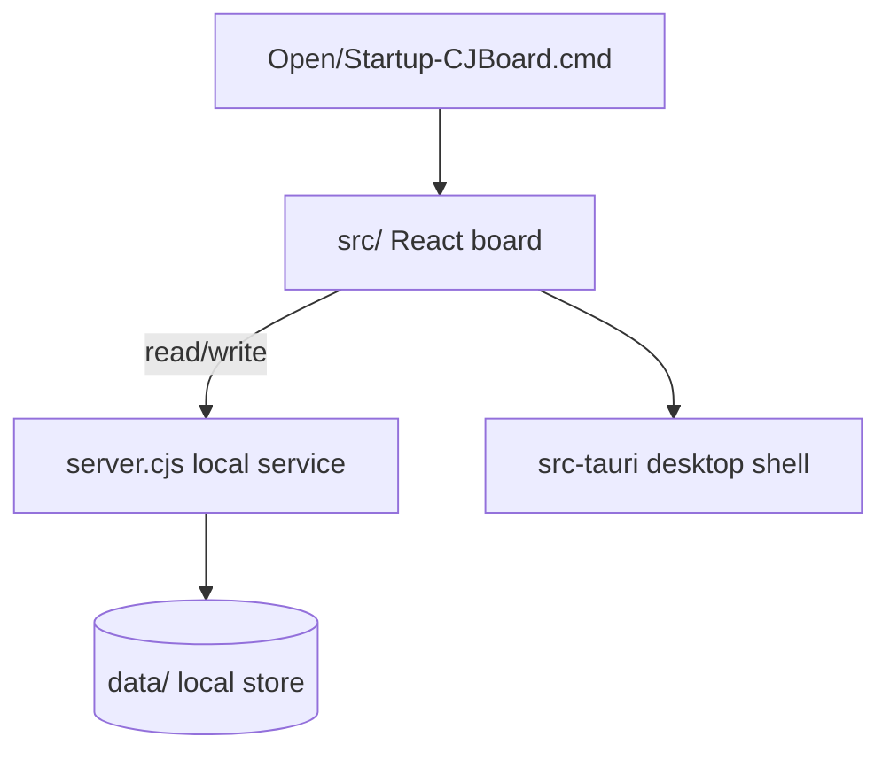

# CJ Board — Learning & Task Kanban (learning-kanban)

A learning/task kanban built with **React + TypeScript + Vite + Tauri**, with a local Node service `server.cjs` and `data/` storage; runs as a desktop app.

## Features
- Learning/task kanban board (columns / drag)
- Desktop packaging via Tauri (`src-tauri/`)
- Local service and launchers (`server.cjs`, `Open-CJBoard.cmd`, `Startup-CJBoard.cmd`)

## Tech Stack
React 19 · TypeScript · Vite · Tauri · Node (server.cjs)

## Architecture & Workflow


## Project Structure
```
learning-kanban/
├─ src/            # React frontend
├─ src-tauri/      # Tauri desktop shell
├─ server.cjs      # local service
├─ data/           # data
├─ scripts/
├─ public/ assets/
├─ package.json / vite.config.ts / tsconfig*.json
└─ README.md / README_EN.md
```

## Getting Started
```
npm install
npm run dev                 # browser dev
# or double-click Open-CJBoard.cmd; desktop build via src-tauri
```

## License
See the repository.